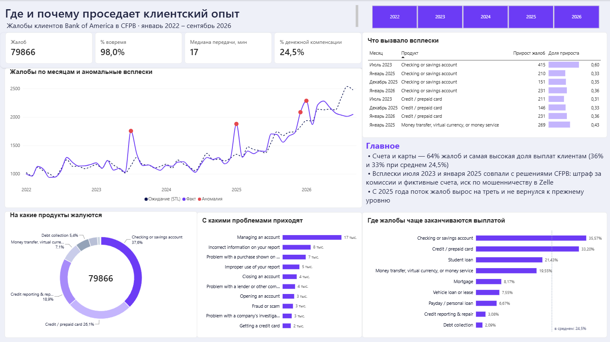

# Где и почему проседает клиентский опыт

Разбор жалоб клиентов Bank of America в CFPB (американский регулятор) за январь 2022 – сентябрь 2026: где жалоб больше всего, когда случаются всплески и чем они вызваны.



## Данные

- **Жалобы** — [CFPB Consumer Complaint Database](https://www.consumerfinance.gov/data-research/consumer-complaints/), фильтр по компании *Bank of America, National Association*, 79 866 жалоб.
- **Население штатов** — U.S. Census Bureau, Vintage 2025 (`NST-EST2025-ALLDATA`), чтобы считать жалобы на 100 тыс. жителей.

Большие CSV в репозиторий не кладу, как их скачать — в [data/README.md](data/README.md).

## Как я это делала

1. Загрузила выгрузку в PostgreSQL как есть (staging), проверила качество и разложила в звезду: факт жалоб + справочники продуктов, проблем и штатов.
2. По пути нашла несколько вещей, которые без проверки испортили бы анализ:
   - в августе 2023 CFPB поменяло классификатор продуктов («Credit card or prepaid card» разделили на две категории и т.д.) — без исправления на графиках были бы ложные обрывы, поэтому сшила старые и новые категории в общие группы;
   - пропуски в выгрузке записаны словом `None`, а не пустой ячейкой;
   - последние месяцы неполные: часть жалоб ещё не закрыта.
3. Посчитала витрины в SQL (CTE, оконные функции) и нашла аномальные месяцы через STL-декомпозицию в statsmodels. Первый запуск выдал 19 «аномалий» из 57 месяцев — на коротком ряду сезонность подстроилась под шум. Зафиксировала сезонность и перестала оценивать последние 3 месяца (краевой эффект), осталось 4 настоящих всплеска.
4. Каждый всплеск разложила по продуктам и проблемам: какой сегмент дал основной прирост.
5. Собрала дашборд в Power BI и обернула всё в `refresh.py`: загрузка → проверки → модель → витрины → аномалии одной командой.

Подробный ход анализа, включая гипотезы, которые не подтвердились, — в [notes.md](notes.md).

## Что получилось

**1. Счета и карты — главный источник и жалоб, и расходов.**
На них приходится 64% всех жалоб, и именно они чаще всего заканчиваются выплатой клиенту: 36% и 33% закрытых жалоб при среднем 24,5%. Для сравнения, кредитные отчёты — третьи по объёму, но выплатой заканчиваются в 3% случаев.
→ Я бы отслеживала не только число жалоб по продукту, но и долю жалоб с выплатой: это сразу показывает, где проблема стоит денег, и задаёт приоритет улучшений.

**2. Два крупных всплеска совпали с решениями регулятора.**
Июль 2023 (+70% к прошлому месяцу): 91% прироста — счета и карты, жалобы на «недостаток средств на счёте» выросли в 9 раз. В том же месяце CFPB оштрафовало банк за двойные комиссии, удержание бонусов по картам и открытие счетов без согласия. Январь 2025: основной прирост — переводы, жалобы на мошенничество и непонятные условия; в конце декабря 2024 CFPB подало иск о мошенничестве в Zelle. Это совпадение по времени и продуктам, а не доказанная причина, но оно очень точное.
→ После публичных решений регулятора стоит заранее ждать волну обращений: усиливать поддержку по затронутым продуктам и проактивно объяснять клиентам, что происходит, а не ждать, пока они пойдут жаловаться.

**3. С 2025 года поток жалоб вырос на треть и не вернулся назад.**
2022–2024 — стабильно 13–14 тыс. жалоб в год, в 2025 — 19 тыс., за 9 месяцев 2026 — уже столько же. Скачок в декабре 2025 – январе 2026 похож не на разовый всплеск, а на переход на новый уровень: растут споры по покупкам по картам и проблемы с управлением счётом. Внешнего события я не нашла.
→ Это главный вопрос для дальнейшего разбора: по данным жалоб видно, где растёт, но не видно почему.

**4. Провал своевременности ответов в конце 2022 – начале 2023.**
Обычно банк отвечает вовремя на 98–99% жалоб, а с ноября 2022 по март 2023 — 87–90%. Поиск аномалий по числу жалоб этого не ловит, потому что поток в те месяцы был обычным.
→ Своевременность нужно мониторить отдельно, со своим порогом, а не надеяться, что проблема проявится в общем числе жалоб.

**5. Среднее время передачи жалобы в банк вводит в заблуждение.**
Среднее — 24 часа, медиана — 17 минут: почти все жалобы уходят в банк сразу, а среднее тянет вверх небольшой хвост очень долгих случаев. На дашборде поэтому медиана, а не среднее.

## Ограничения

- Жалобы в CFPB — только часть недовольных клиентов: многие идут в банк напрямую.
- Рейтинг штатов посчитан на 100 тыс. жителей, а не клиентов. Банк представлен в штатах неравномерно, поэтому высокий показатель — повод присмотреться, а не вывод.
- Классификатор проблем тоже менялся в 2023 году, поэтому сравнивать отдельные проблемы до и после смены нужно осторожно.

## Как запустить

```bash
pip install -r requirements.txt
cp .env.example .env          # вписать пароль от PostgreSQL
# скачать CSV в data/ (см. data/README.md)
python src/build_states.py    # справочник штатов из файла Census
python src/refresh.py         # весь пайплайн
```

Потом открыть `dashboard/complaints_dashboard.pbix` и нажать «Обновить».

```
data/        справочник штатов + инструкция, где скачать CSV
sql/         модель, проверки качества, витрины, исследование
src/         загрузка, поиск аномалий, refresh.py
dashboard/   Power BI
notes.md     ход анализа
```

Стек: PostgreSQL, Python (pandas, statsmodels, SQLAlchemy), Power BI, Git.
